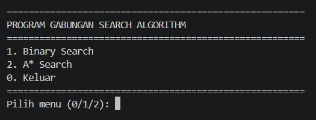

# SEARCH ALGORYTHM SYSTEM
The Search Algorithm System is a Python-based program that combines two search algorithms: Binary Search and A* Search. The program allows users to select and execute an algorithm through a menu in a single Python file named Gabungan.py.

Binary Search is used to find a target value in a sorted list by repeatedly dividing the search interval into two halves. Meanwhile, A* Search is used to find an optimal path from a starting node to a destination node by considering the cost of the path and a heuristic estimate of the remaining distance.

## Key Features

* **Binary Search:** Finds a target value in a sorted list efficiently.
* **A Search:** Finds a path between two nodes using path costs and heuristic values.
* **Interactive Menu:** Allows users to select which algorithm to execute.
* **Search Results:** Displays the search result, index, number of steps, path, or total cost, depending on the selected algorithm.
* **Single-File Execution:** Both algorithms can be accessed through Gabungan.py.

## Screenshots

| Main Menu | Choose Learning Problem | Learning Recommendation |Conclusion |
| :---: | :---: | :---: | :---: |
|  |  |  |  |


## Limitations

### 1. Sorted List Requirement
   Binary Search requires the data to be sorted before searching to ensure accurate results.
### 2. Graph and Heuristic Dependency
   A* Search depends on the graph structure and heuristic values to determine the path. An unsuitable heuristic may affect the optimality of the result.
### 3. Predefined Data
   The search data, graph connections, and heuristic values are predefined in the program and cannot be modified dynamically during execution.
   
To run this project, you only need Python installed with standard libraries:

* Python 3.x (no external third-party libraries required)

## Installation

1.  **Open Comand Promt terminal in Vscode and Clone the repository**
    ```bash
    git clone https://github.com/DNALWANA/AI-EL1-09.git
    ```

2.  **Search Folder**
    ```bash
    cd AI-EL1-09/"Pertemuan 4/Search Algorythm/Manager"
    ```

3.  **Verify Python Installation**
    ```bash
    python3 --version
    ```

## Usage
```bash
python3 Gabungan.py
```

## How to run the program

### 1. Binary Search
Provide a target integer when requested. The algorithm checks the middle element, narrows the search interval, and repeats the process until the target is found or the interval becomes empty.

### 2. A* Search
Provide a starting node and a destination node, such as A and G. The algorithm evaluates nodes using the formula:

**f(n) = g(n) + h(n)**

Where:
**f(n)** is the estimated total path cost.
**g(n)** is the actual cost from the starting node to the current node.
**h(n)** is the estimated cost from the current node to the goal.

## Result

### 1. Binary Search Result
The example program uses the following sorted list:

**[2, 5, 8, 12, 16, 23, 38, 56, 72, 91]**

When searching for 23, the algorithm returns index 5, which is the sixth element because Python indexing starts at 0.
This demonstrates how Binary Search efficiently locates a value by reducing the search interval at each step.

### 2. A* Search Result
When searching from node A to node G, the example graph produces the following minimum-cost path:
**A -> B -> D -> G**

Total path cost:
1 + 2 + 3 = 6
This result demonstrates how A* Search uses path costs and heuristic estimates to find a low-cost route through a weighted graph.


